<div align="center">

<picture>
  <source media="(prefers-color-scheme: dark)" srcset="docs/visuals/hero-dark.svg">
  <source media="(prefers-color-scheme: light)" srcset="docs/visuals/hero-light.svg">
  
</picture>

<br>

[](https://github.com/z33shxn/herdbench/actions/workflows/ci.yml)
[](pyproject.toml)
[](docs/timestamps/)
[](LICENSE)
[](results/)

**[What we found](#what-we-found)** &nbsp;·&nbsp; **[How it works](#how-it-works)** &nbsp;·&nbsp;
**[Use it](#use-it-in-two-minutes)** &nbsp;·&nbsp; **[For quants](#for-quants-the-full-detail)** &nbsp;·&nbsp;
**[Full results](docs/results.md)**

</div>

## The idea

Everyone in a market wants to know which way everyone else is betting. Real positions are normally private, so
traders read the crowd from public gauges instead: funding rates, long/short ratios, open interest, price momentum.
Checking those gauges was close to impossible, because the crowd itself stayed hidden.

On one exchange, the crowd is in plain sight: **Hyperliquid publishes every account's open positions.** HerdBench
used that to rebuild what the whole crowd really held, every day for a year, and then graded the popular gauges
against the truth, under a plan that was sealed before any result existed.

## How it works

<picture>
  <source media="(prefers-color-scheme: dark)" srcset="docs/visuals/how-dark.svg">
  <source media="(prefers-color-scheme: light)" srcset="docs/visuals/how-light.svg">
  
</picture>

## What we found

<picture>
  <source media="(prefers-color-scheme: dark)" srcset="docs/visuals/scorecard-dark.svg">
  <source media="(prefers-color-scheme: light)" srcset="docs/visuals/scorecard-light.svg">
  
</picture>

<p align="center"><sub>Mean within-market Spearman ρ with 95% block-bootstrap intervals; 30 markets, 297 days.
Numbers: <a href="results/binance/primary_family.csv"><code>results/binance/primary_family.csv</code></a>.</sub></p>

Two of the seven signals passed. In plain words:

* **The price premium is the best public read of the crowd.** When the futures price climbs further above spot,
  the crowd tends to be more net long.
* **The crowd chases winners.** After prices rise, traders hold more longs. The link is weak, but it held up in
  every robustness check.
* **Binance's long/short ratios did not pass.** The all-accounts ratio follows how many traders are long, which is
  not the same as where the money is, and none of the three tracks which way the crowd's money leans.
* **Open interest and taker-flow signals showed no useful link** to which way the crowd was positioned.

<picture>
  <source media="(prefers-color-scheme: dark)" srcset="docs/visuals/insights-dark.svg">
  <source media="(prefers-color-scheme: light)" srcset="docs/visuals/insights-light.svg">
  
</picture>

<p align="center"><sub>Numbers: <a href="results/directional_primary.csv"><code>directional_primary.csv</code></a>,
<a href="results/binance/cross_venue.csv"><code>binance/cross_venue.csv</code></a> and
<a href="results/liquidation_target.csv"><code>liquidation_target.csv</code></a> in <code>results/</code>.</sub></p>

## Sealed before the results

<picture>
  <source media="(prefers-color-scheme: dark)" srcset="docs/visuals/timeline-dark.svg">
  <source media="(prefers-color-scheme: light)" srcset="docs/visuals/timeline-light.svg">
  
</picture>

Every test, threshold and verdict rule was written down first and anchored in the Bitcoin blockchain, so nobody
(the author included) could move the goalposts after seeing the data. The receipt:

| | |
|---|---|
| Plan registered | commit [`f205501`](https://github.com/z33shxn/herdbench/commit/f20550163724caff8fc78429c6c780269b78f290), anchored in Bitcoin block 976,330 (17 Nov 2026, 22:07 UTC) |
| Code frozen | commit [`a77b84d`](https://github.com/z33shxn/herdbench/commit/a77b84d2f515d5c394986df3163a5772c0b4f1a9), with the pre-analysis addendum, before any signal met the truth |
| Primary test | each signal's within-market Spearman correlation with ni(non_mm), 30 markets, Holm-corrected across 7 signals |
| Verdict rules | *confirmed*: expected sign, Holm p < 0.05, beats the rotation null and the fixed-effects slope agrees; *reversed*: the same with the opposite sign; *uninformative*: 90% interval inside ±0.10; *inconclusive*: none of these |

The proofs, and how to check them yourself, are in [docs/timestamps](docs/timestamps/).

## Use it in two minutes

```bash
pip install "herdbench @ git+https://github.com/z33shxn/herdbench"
herdbench info
```

```python
import herdbench

panel = herdbench.load_truth_panel(cohort="non_mm")   # date x market truth: ni, ai, lwi, crowding metrics
report = herdbench.grade(my_signal)                   # your signal vs the real crowd, with the study's baselines
print(report)
```

The truth panel ships inside the package: no download, no account, no API key.
`herdbench panel --out panel.parquet` exports it for any other tool.

---

## For quants: the full detail

### Headline results

Registered study: 30 primary markets, 297 snapshot dates (28 August 2025 to 18 August 2026), 8,566 market-days.
Truth: net positioning of the crowd without market makers, ni(non_mm). Statistic: within-market Spearman correlation
over time, averaged across markets on Fisher's z scale, with a 95% circular block-bootstrap interval; the seven
confirmatory proxies are Holm-corrected together.

| Proxy | ρ [95% interval] | Verdict |
|---|---|---|
| `premium_24h` (perp premium over the oracle, last 24 hours) | 0.295 [0.223, 0.402] | **confirmed** |
| `momentum_7d` (7-day return) | 0.136 [0.073, 0.211] | **confirmed** |
| `bn_top_position_ls` (Binance top-trader position ratio) | 0.094 [-0.000, 0.175] | inconclusive |
| `bn_top_account_ls` (Binance top-trader account ratio) | 0.064 [-0.027, 0.160] | inconclusive |
| `bn_global_ls` (Binance global account ratio) | 0.026 [-0.074, 0.137] | inconclusive |
| `bn_taker_ls` (Binance taker buy/sell volume) | 0.025 [-0.001, 0.058] | uninformative |
| `oi_flow_7d` (open-interest change signed by momentum) | -0.024 [-0.074, 0.030] | uninformative |

* **Premium.** Funding is the premium clamped to an interest rate, and it sat on its floor in 57% of hours. It
  scores the same as the premium (0.295), so the premium carries the information without the clamp.
* **Momentum.** Seven-day momentum tracks net positioning weakly but reliably, and the positive control (momentum
  against trend followers) comes out above zero, as it must.
* **Exchange long/short ratios.** No Binance ratio tracks net positioning, but the global ratio does track the share
  of accounts that are long: 0.349 [0.263, 0.446] against ai(all). The top-trader position ratio does not track the
  largest accounts' net positioning: -0.061 [-0.171, 0.034].
* **Open interest and taker flow** are uninformative: their 90% intervals lie inside ±0.10.
* **Fragility.** The share of positions within 10% of their liquidation price predicts next week's liquidations
  across markets (ρ = 0.47; 0.50 controlling for volatility), and out of sample it does no better than last week's
  liquidations.
* **US single-stock perps.** Equity short interest agrees only weakly with perp positioning (settlement-date short
  interest, β = -0.08, p = 0.049; nothing at publication). With 14 tests, read this as weak evidence.

Both confirmed proxies stay clear of zero under every alternative market-maker rule (premium 0.20 to 0.39, momentum
0.13 to 0.19), and the published panel alone gives the same verdicts. Only two verdicts are decisive, so no ranking
beyond them is claimed. Integrity gates: snapshots reconcile with the fills between them on 99.5% of changed
notional (the shortfall sits in two snapshot pairs with holes in the source archive), and maker notional equals
taker notional on 100% of 88,711 market-days. Every table and figure: [docs/results.md](docs/results.md).

### Why this benchmark is new

Positioning is almost never observed. Funding, basis, open-interest changes and exchange long/short ratios are read
as crowding signals precisely because the books behind them are private. On Hyperliquid every account's open
position is published, so for once the truth can be measured for the whole market, every day, and the signals can
be graded against it.

HerdBench measures **net positioning of the crowd**. Every long has a short, so all accounts together net to zero;
the informative quantity is what remains after removing market makers and protocol accounts,
`ni(non_mm) = -(market-maker net + protocol net) ÷ non_mm gross`. Sub-accounts are merged into their master
account first, so one firm counts once.

### Grade your own signal

`grade()` takes a table with `date`, `market` and one value column (pandas or polars), a pandas Series indexed by
`(date, market)`, or a wide frame (dates × markets). It returns the within-market Spearman correlation averaged on
Fisher's z scale with a block-bootstrap interval, plus the cross-sectional correlation, daily changes, a placebo
(truth shifted 60 days), the two-way fixed-effects slope, sign agreement and tail lift, for your signal and for the
study's own Hyperliquid-native baselines **on exactly the same market-days**.

```bash
herdbench grade my_signal.csv --truth ni --cohort non_mm --json report.json
```

Two rules keep the comparison honest:

1. **Timing.** A value for snapshot date D may use only information from before that snapshot's `cutoff` (a column
   of the panel; usually D 00:00 UTC). Plain dates are read as snapshot dates; timestamped values move to the first
   snapshot whose cutoff is at or after them, so nothing is scored against a snapshot taken before the value was
   known. The study's own proxies obey the same rule.
2. **Labelling.** Results are labelled *in-sample, published panel*: the panel contains only the cells that pass
   disclosure control, rounded. The pre-registered headline results were computed on every cell and ship as fixed
   tables in [`results/`](results/).

Truth metrics you can grade against: `ni`, `ai` (account imbalance), `lwi` (leverage-weighted imbalance) and the
crowding metrics `abs_ni`, `top10_share`, `fragile_share`, `coheld_share`, `dtl` (days to liquidate). Cohorts: `all`,
`non_mm`, `top_av` (largest 20% by lagged account value), `trend`, `contrarian`. Definitions:
[docs/methodology.md](docs/methodology.md).

### What is in the truth panel

One row per snapshot date, market and cohort, for every cell that passes disclosure control.

| Column | Meaning |
|---|---|
| `date`, `cutoff` | Snapshot date and the proxy cutoff (last full UTC hour before the snapshot was captured) |
| `market`, `dex` | Market name and venue (`main` or a builder-deployed dex such as `xyz`) |
| `cohort` | `all`, `non_mm`, `top_av`, `trend` or `contrarian` |
| `n_entities` | Entities in the cell, rounded down to a multiple of 10 |
| `gross_notional`, `net_notional` | Cohort gross and net position notional (2 significant figures) |
| `ni`, `ai`, `lwi` | Net, account and leverage-weighted imbalance (3 decimals) |
| `abs_ni`, `top10_share`, `fragile_share`, `coheld_share` | Crowding metrics (3 decimals) |
| `dtl` | Days to liquidate: \|cohort net notional\| ÷ mean daily taker volume over the prior 7 days |
| `oi_notional`, `eligible` | Market open interest; eligible if open interest at the previous snapshot was at least $1M |

No address and no entity-level row is ever published. A cell is published only with at least 20 entities and its
two largest entities holding at most 80% of its gross notional; a complement rule stops any cell being recovered by
subtracting two published ones ([docs/data.md](docs/data.md)).

### How the study is built

* **Truth** comes from daily snapshots of every open position, reconciled against every fill between snapshots.
  Entities are master accounts with their sub-accounts; market makers are identified from their trading and set
  aside, leaving cohorts of everyone else, the largest accounts, trend followers and contrarians.
* **Proxies** use only data stamped before each snapshot's cutoff, so none can see the positions it is scored on.
* **Statistics** are fixed in the [pre-registration](docs/preregistration.md): within-market Spearman correlations
  averaged on the z scale, a circular block bootstrap with shared draws, a rotation null, a two-way fixed-effects
  slope, Holm correction for the confirmatory family, Benjamini-Hochberg flags on the secondary grids and four
  verdicts (confirmed, reversed, uninformative, inconclusive).
* **Extensions** score liquidation risk, transfer to US single-stock perps against FINRA short interest, and
  describe CFTC positioning bridges.

Full method: [docs/methodology.md](docs/methodology.md). Data sources and licences: [docs/data.md](docs/data.md).
Rebuilding every number from public data: [docs/reproduce.md](docs/reproduce.md).

### Integrity

* **Pre-registered and timestamped.** Every parameter is in [docs/preregistration.md](docs/preregistration.md) and
  in code (`herdbench.config.PREREG`); a test fails if the two disagree. The registering commit and the pre-analysis
  addendum are anchored with OpenTimestamps proofs in [docs/timestamps/](docs/timestamps/). Scoring refuses to run
  without the addendum.
* **Gated.** Every result depends on two gates computed on the full archive: snapshots must reconcile with fills,
  and maker notional must equal taker notional.
* **Reproducible.** `herdbench fetch`, `herdbench build entities` and `herdbench build all` rebuild every number
  from public data; `herdbench check` cross-checks the funding inputs against the venue's own API;
  [`results/manifest.json`](results/manifest.json) holds the SHA-256 of every published file. The test suite builds
  a complete synthetic archive and runs the whole pipeline offline on Linux, Windows and macOS, Python 3.10 to 3.13.
* **No hand-made charts.** Every image on this page is drawn from `results/` by `herdbench visuals`, and a test
  fails if an image drifts from the numbers.
* **Deviations are reported**, with the registered version still run:
  [docs/results.md](docs/results.md#10-deviations-from-the-pre-registration).

### Licences

| What | Licence |
|---|---|
| Code | Apache-2.0 ([LICENSE](LICENSE), [NOTICE](NOTICE)) |
| Truth panel, native proxies and statistics in `results/` | CC BY 4.0 |
| Statistics involving Binance data, in `results/binance/` (including the primary family) | CC BY-NC-SA 4.0 |
| Statistics from FINRA short interest, in `results/finra/` | FINRA's terms (source and owner FINRA; non-commercial) |
| Images in `docs/visuals/` | As their numbers: the scorecard and insights images use Binance statistics (CC BY-NC-SA 4.0); the rest CC BY 4.0 |

Raw inputs are never redistributed. Details: [docs/data.md](docs/data.md).

### Limitations

* One venue and one year (28 August 2025 to 18 August 2026). Hyperliquid's crowd is not a sample of equity funds.
* The books are complete on this venue but not across venues: the same traders may hold offsetting positions
  elsewhere.
* The study measures agreement between signals and positioning. It makes no causal claim and estimates no
  crowding premium.
* Entities are merged through the venue's own sub-account links for market-maker candidates and top holders; other
  addresses count as their own entity, so a firm using unlinked wallets can count more than once.

### Citation

See [CITATION.cff](CITATION.cff). Author: Mohammed Zeeshan.
