<div align="center">

<picture>
  <source media="(prefers-color-scheme: dark)" srcset="docs/visuals/hero-dark.svg">
  <source media="(prefers-color-scheme: light)" srcset="docs/visuals/hero-light.svg">
  
</picture>

<br>

[](https://github.com/z33shxn/herdbench/actions/workflows/ci.yml)
[](pyproject.toml)
[](docs/timestamps/)
[](LICENSE)
[](#licences)

**[How it works](#how-it-works)** &nbsp;·&nbsp; **[What we found](#what-we-found)** &nbsp;·&nbsp;
**[Sealed before the results](#sealed-before-the-results)** &nbsp;·&nbsp; **[Use it](#use-it-in-two-minutes)**
&nbsp;·&nbsp; **[For quants](#for-quants-the-full-detail)** &nbsp;·&nbsp; **[Full results](docs/results.md)**

</div>

## The idea

Everyone in a market wants to know which way everyone else is betting. Real positions are normally private, so
traders read the crowd from public gauges instead: funding rates, long/short ratios, open interest, price momentum.
Checking those gauges was close to impossible, because the crowd itself stayed hidden.

On one exchange, the crowd is in plain sight: **Hyperliquid publishes every account's open positions.** HerdBench
used that to rebuild what the whole crowd really held on 305 days over a year, then graded the popular gauges
against the truth, under a plan that was sealed before any result existed.

<details>
<summary>New to these words?</summary>

A **long** is a bet that the price will rise; a **short**, that it will fall. A **perpetual future** (a "perp") is a
contract that tracks a coin's price with no expiry date. Its **funding rate** is a small fee one side pays the other
to keep the contract's price near the spot price, and its **premium** is how far the contract's price sits above
the spot price. **Open interest** is the total size of the open contracts. **Market makers** quote both sides all
day instead of betting on a direction, so they are set aside. A **liquidation** is the forced closing of a position
whose losses have used up its margin.

</details>

## How it works

<picture>
  <source media="(prefers-color-scheme: dark)" srcset="docs/visuals/how-dark.svg">
  <source media="(prefers-color-scheme: light)" srcset="docs/visuals/how-light.svg">
  
</picture>

## What we found

<picture>
  <source media="(prefers-color-scheme: dark)" srcset="docs/visuals/scorecard-dark.svg">
  <source media="(prefers-color-scheme: light)" srcset="docs/visuals/scorecard-light.svg">
  
</picture>

<p align="center"><sub>Mean within-market Spearman ρ with 95% block-bootstrap intervals; 30 markets, 297 days.
Numbers: <a href="results/binance/primary_family.csv"><code>results/binance/primary_family.csv</code></a>.</sub></p>

<details>
<summary>The scorecard as a table</summary>

| Signal | Score | Verdict |
|---|---:|---|
| Price premium | 0.29 | Tracks the crowd |
| Price momentum | 0.14 | Tracks the crowd |
| Binance, top traders' positions | 0.09 | Too close to call |
| Binance, top traders' accounts | 0.06 | Too close to call |
| Binance, all accounts | 0.03 | Too close to call |
| Binance, taker flow | 0.03 | No useful link |
| Open interest flow | -0.02 | No useful link |

The score is how closely a signal follows the crowd's net position inside each market over time: a rank
correlation that runs from -1 to 1, where 0 means no link.

</details>

Two of the seven signals passed. In plain words:

* **The price premium passed, with the highest score of the seven (0.29).** When Hyperliquid's futures price sits
  further above the spot price than usual, its crowd tends to be more net long than usual.
* **After prices rise, the crowd leans more long.** Momentum passed too, but weakly, and only over time within each
  coin: on a given day, the coins that rose most do not have the most net-long crowds.
* **Binance's long/short ratios did not pass.** The all-accounts ratio follows how many traders are long, which is
  not the same as where the money is. Against the crowd's money, all three were too close to call; the top traders'
  position ratio came closest (0.09).
* **Open interest and taker-flow signals showed no useful link** to which way the crowd was positioned.
* **Funding rates were checked too, outside the seven.** On Hyperliquid, funding is the price premium held inside a
  band, so it scores the same as the premium (0.29) by design and adds nothing to it.

The scores describe the signals; with only two clear verdicts, the study claims no ranking between them.

<picture>
  <source media="(prefers-color-scheme: dark)" srcset="docs/visuals/insights-dark.svg">
  <source media="(prefers-color-scheme: light)" srcset="docs/visuals/insights-light.svg">
  
</picture>

<p align="center"><sub>Numbers: <a href="results/directional_primary.csv"><code>directional_primary.csv</code></a>,
<a href="results/binance/primary_family.csv"><code>binance/primary_family.csv</code></a>,
<a href="results/binance/cross_venue.csv"><code>binance/cross_venue.csv</code></a> and
<a href="results/liquidation_target.csv"><code>liquidation_target.csv</code></a> in <code>results/</code>.</sub></p>

## Sealed before the results

<picture>
  <source media="(prefers-color-scheme: dark)" srcset="docs/visuals/timeline-dark.svg">
  <source media="(prefers-color-scheme: light)" srcset="docs/visuals/timeline-light.svg">
  
</picture>

Every test, threshold and verdict rule was written down and anchored in the Bitcoin blockchain before any signal was
compared with the truth, so the rules could not be changed after the results were seen. The data themselves are
historical and public; what the author looked at before registering, including a small pilot on other data, is
listed in section 2 of the pre-registration. The receipt:

| | |
|---|---|
| Plan registered | commit [`f205501`](https://github.com/z33shxn/herdbench/blob/f20550163724caff8fc78429c6c780269b78f290/docs/preregistration.md), 17 Nov 2026 at 21:42 UTC (18 November in the author's time zone, UTC+5:30), anchored in Bitcoin block 976,330 at 22:07 UTC |
| Code frozen | commit [`a77b84d`](https://github.com/z33shxn/herdbench/commit/a77b84d2f515d5c394986df3163a5772c0b4f1a9), with the pre-analysis addendum, before any signal met the truth. This order rests on the git history: the addendum's own Bitcoin anchor (block 977,225, 14:59 UTC) came seven and a half minutes after scoring started |
| Primary test | how closely each signal follows the crowd's net position inside each market over time (a rank correlation), across 30 markets, corrected for testing 7 signals at once |
| Verdict rules | *tracks the crowd*: the link points the expected way, survives that correction, beats a shifted-timing benchmark and keeps its sign in a model with market and date effects; *points the wrong way*: the same with the opposite sign; *no useful link*: the link is shown to be smaller than 0.10 either way; *too close to call*: none of these |

The copy of `docs/preregistration.md` on `main` differs from the registered file only in its dashes (the house
style since v1.1.0). The registered file is at commit `f205501` and hashes to `ae32842f...`, the value in the
Bitcoin-anchored record. The proofs, and how to check them yourself, are in [docs/timestamps](docs/timestamps/).

## Use it in two minutes

```bash
pip install "herdbench @ git+https://github.com/z33shxn/herdbench"
herdbench info
```

```python
import herdbench

panel = herdbench.load_truth_panel(cohort="non_mm")   # the truth: date x market, with ni, ai, lwi and crowding metrics

# Any table with date, market and one value column; here, the study's own 7-day momentum.
my_signal = herdbench.load_proxies().select(["date", "market", "momentum_7d"])
print(herdbench.grade(my_signal))                     # your signal vs the real crowd, with the study's baselines
```

The truth panel ships inside the package: no download, no account, no API key.
`herdbench panel --out panel.parquet` exports it for any other tool.

---

## For quants: the full detail

### Headline results

Registered study: 30 primary markets (the 30 largest main-dex markets by open interest on the 27 August 2025
snapshot that have a USDT-margined Binance perpetual), 297 scored dates out of 305 snapshot dates between 28 August
2025 and 18 August 2026 (the source archive has no snapshots from 25 October to 14 December 2025), 8,566 market-days.
Truth: net positioning of the crowd without market makers, ni(non_mm). Statistic: within-market Spearman correlation
over time, averaged across markets on Fisher's z scale, with a 95% circular block-bootstrap interval; the seven
confirmatory proxies are Holm-corrected together.

| Proxy | ρ [95% interval] | Verdict |
|---|---|---|
| `premium_24h` (perp premium over the oracle, last 24 hours) | 0.295 [0.223, 0.402] | **confirmed** |
| `momentum_7d` (7-day return) | 0.136 [0.073, 0.211] | **confirmed** |
| `bn_top_position_ls` (Binance top-trader position ratio) | 0.094 [-0.000, 0.175] | inconclusive |
| `bn_top_account_ls` (Binance top-trader account ratio) | 0.064 [-0.027, 0.160] | inconclusive |
| `bn_global_ls` (Binance global account ratio) | 0.026 [-0.074, 0.137] | inconclusive |
| `bn_taker_ls` (Binance taker buy/sell volume) | 0.025 [-0.001, 0.058] | uninformative |
| `oi_flow_7d` (open-interest change signed by momentum) | -0.024 [-0.074, 0.030] | uninformative |

<sub>The table contains statistics derived from Binance Vision data: CC BY-NC-SA 4.0.</sub>

* **Premium.** Funding is the premium clamped to an interest rate, and it sat exactly at the baseline rate (0.01%
  per 8 hours) in 57% of hours. It scores the same as the premium (0.295), as it must by construction, so the premium
  carries the information without the clamp. The premium's link also holds across markets on a given day
  (cross-sectional ρ 0.40) and in the two-way fixed-effects slope (t = 5.3). Binance's funding rate scores 0.077
  [0.022, 0.152] against the same truth (a secondary statistic).
* **Momentum.** Seven-day momentum tracks net positioning within markets over time (0.136), and the link held under
  every alternative market-maker rule, in both halves of the sample and on the published panel. It is a time-series
  link: the daily cross-sectional correlation is -0.011 (p = 0.73), and the two-way fixed-effects slope, which nets
  out common daily moves, is 0.001 (s.e. 0.021). The positive control (momentum against trend followers) comes out
  above zero, as it must.
* **Exchange long/short ratios.** No Binance ratio is confirmed against net positioning. All three are
  inconclusive; the top-trader position ratio comes closest (0.094, 90% interval [0.014, 0.164], Holm p = 0.26). The
  global ratio does track the share of accounts that are long: 0.349 [0.263, 0.446] against ai(all). The top-trader
  position ratio does not track the largest accounts' net positioning: -0.061 [-0.171, 0.034].
* **Open interest and taker flow** are uninformative: their 90% intervals lie inside ±0.10.
* **Fragility.** The share of open notional within 10% of its liquidation price predicts next week's liquidations
  across markets (ρ = 0.47; 0.50 controlling for volatility), and out of sample it does no better than last week's
  liquidations.
* **US single-stock perps.** No short-interest measure clearly agrees with perp positioning. Paired at the settlement
  date, more short interest goes with a more net-short perp crowd (standardised β = -0.08, p = 0.049), but the effect
  loses significance with two-way clustered errors (s.e. 0.045), nothing shows when paired at the publication date,
  and none survives correction for 14 tests.

Both confirmed proxies stay clear of zero under every alternative market-maker rule (premium 0.20 to 0.39, momentum
0.13 to 0.19), and the published panel alone gives the same verdicts. With only two decisive verdicts, no ranking is
claimed (kill criterion 4); the ranks in [docs/results.md](docs/results.md) are descriptive. Integrity gates:
snapshots reconcile with the fills between them on 99.5% of changed notional (the shortfall sits in two snapshot
pairs with holes in the source archive), and maker notional equals taker notional on 100% of 88,711 market-days.
Every table and figure: [docs/results.md](docs/results.md).

### Why this benchmark is new

Positioning is almost never observed. Funding, basis, open-interest changes and exchange long/short ratios are read
as crowding signals because the books behind them are private. On Hyperliquid every account's open position is
published, so for once the truth can be measured for the whole market, every day the archive covers, and the signals
can be graded against it.

HerdBench measures **net positioning of the crowd**. Every long has a short, so all accounts together net to zero;
the informative quantity is what remains after removing market makers and protocol accounts,
`ni(non_mm) = -(market-maker net + protocol net) ÷ non_mm gross`. Sub-accounts of market-maker candidates and top
holders are merged into their master account first, through the venue's own sub-account links, so a firm's linked
accounts count once (unlinked wallets still count separately; see [Limitations](#limitations)).

### Grade your own signal

`grade()` takes a table with `date`, `market` and one value column (pandas or polars), a pandas Series indexed by
`(date, market)`, or a wide frame (dates × markets). It returns the within-market Spearman correlation averaged on
Fisher's z scale with a block-bootstrap interval, plus the cross-sectional correlation, daily changes, a placebo
(truth shifted 60 days), the two-way fixed-effects slope, sign agreement and tail lift, for your signal and for the
study's own Hyperliquid-native baselines **on exactly the same market-days**.

```bash
herdbench grade my_signal.csv --truth ni --cohort non_mm --json report.json
```

Three rules keep the comparison honest:

1. **Timing.** A value for snapshot date D may use only information from before that snapshot's `cutoff` (a column
   of the panel; usually D 00:00 UTC). Plain dates are read as snapshot dates; timestamped values move to the first
   snapshot whose cutoff is at or after them, so nothing is scored against a snapshot taken before the value was
   known. A daily value computed from day D's data is known only after D ends: label it D+1, or pass the time it
   became known (for a bar, its close time) and `grade()` aligns it. The study's own proxies obey the same rule.
2. **Labelling.** Results are labelled *in-sample, published panel*: the panel contains only the cells that pass
   disclosure control, rounded. The pre-registered headline results were computed on every cell and ship as fixed
   tables in [`results/`](results/).
3. **Universe.** By default `grade()` uses every eligible market your signal covers, so its baselines differ from the
   headline table. To compare with that table, pass `markets=` with the 30 primary markets (`primary_markets` in
   [`results/score_summary.json`](results/score_summary.json)).

Truth metrics you can grade against: `ni`, `ai` (account imbalance), `lwi` (leverage-weighted imbalance) and the
crowding metrics `abs_ni`, `top10_share`, `fragile_share`, `coheld_share`, `dtl` (days to liquidate). Cohorts: `all`,
`non_mm`, `top_av` (largest 20% by lagged account value), `trend`, `contrarian`. Definitions:
[docs/methodology.md](docs/methodology.md).

### What is in the truth panel

One row per snapshot date, market and cohort, for every cell that passes disclosure control.

| Column | Meaning |
|---|---|
| `date`, `cutoff` | Snapshot date and the proxy cutoff (last full UTC hour before the snapshot was captured) |
| `market`, `dex` | Market name and venue (`main` or a builder-deployed dex such as `xyz`) |
| `cohort` | `all`, `non_mm`, `top_av`, `trend` or `contrarian` |
| `n_entities` | Entities in the cell, rounded down to a multiple of 10 |
| `gross_notional`, `net_notional` | Cohort gross and net position notional (2 significant figures) |
| `ni`, `ai`, `lwi` | Net, account and leverage-weighted imbalance (3 decimals) |
| `abs_ni`, `top10_share`, `fragile_share`, `coheld_share` | Crowding metrics (3 decimals) |
| `dtl` | Days to liquidate: \|cohort net notional\| ÷ mean daily taker volume over the prior 7 days |
| `oi_notional`, `eligible` | Market open interest; eligible if open interest at the previous snapshot was at least $1M |

No address and no entity-level row is ever published. A cell is published only with at least 20 entities and its
two largest entities holding at most 80% of its gross notional; a complement rule stops any cell being recovered by
subtracting two published ones ([docs/data.md](docs/data.md)).

### How the study is built

* **Truth** comes from daily snapshots of every open position in a public archive of Hyperliquid's ledger (a
  Hugging Face mirror pinned to one revision; [docs/data.md](docs/data.md)), reconciled against the fills between
  consecutive snapshots (261 pairs). Entities are master accounts with their linked sub-accounts; market makers are
  identified from their trading and set aside, leaving cohorts of everyone else, the largest accounts, trend
  followers and contrarians.
* **Proxies** use only data stamped before each snapshot's cutoff, so none can see the positions it is scored on.
* **Statistics** are fixed in the [pre-registration](https://github.com/z33shxn/herdbench/blob/f20550163724caff8fc78429c6c780269b78f290/docs/preregistration.md):
  within-market Spearman correlations averaged on the z scale, a circular block bootstrap with shared draws, a
  rotation null, a two-way fixed-effects slope, Holm correction for the confirmatory family, Benjamini-Hochberg flags
  on the secondary grids and four verdicts (confirmed, reversed, uninformative, inconclusive).
* **Extensions** score liquidation risk, test whether the signals carry over to US single-stock perps (against FINRA
  short interest), and describe how CFTC futures positioning lines up with the matching perps.

Full method: [docs/methodology.md](docs/methodology.md). Data sources and licences: [docs/data.md](docs/data.md).
Rebuilding every number from public data: [docs/reproduce.md](docs/reproduce.md).

### Integrity

* **Pre-registered and timestamped.** Every registered parameter is in the
  [pre-registration](https://github.com/z33shxn/herdbench/blob/f20550163724caff8fc78429c6c780269b78f290/docs/preregistration.md)
  and in code (`herdbench.config.PREREG`); a test fails if the two disagree. The few constants the registration left
  to the code were fixed before scoring and are listed in [docs/methodology.md](docs/methodology.md) (section 23)
  and [docs/deviations.md](docs/deviations.md). The registering commit and the pre-analysis addendum are anchored
  with OpenTimestamps proofs in [docs/timestamps/](docs/timestamps/). Scoring refuses to run without the addendum.
* **Gated.** Every result depends on two gates computed on the full archive: at least 99% of changed notional must
  reconcile with the fills, and maker and taker notional must agree within 1% on at least 99% of market-days (both
  passed: 99.5% and 100%).
* **Reproducible.** `herdbench fetch` (about 25 GB), `herdbench build entities` (several hours) and
  `herdbench build all` rebuild every number from public data. A rerun should agree closely but not always exactly:
  the entity map comes from live API answers, and the Binance, FINRA and CFTC inputs are not pinned (`--strict` says
  whether you reproduced the registered entity map). `herdbench check` cross-checks the funding inputs against the
  venue's own API, and [`results/manifest.json`](results/manifest.json) holds the SHA-256 of every published file.
  The test suite builds a complete synthetic archive and runs the whole pipeline offline on Linux, Windows and
  macOS, Python 3.10 to 3.13. Details: [docs/reproduce.md](docs/reproduce.md).
* **No hand-made charts.** Every chart on this page is drawn by `herdbench visuals` from `results/`, the truth panel
  and the timestamp record, and a test fails if an image drifts from them
  ([how the images are made](docs/visuals/README.md)).
* **Deviations are reported**, with the registered version still run:
  [docs/results.md](docs/results.md#10-deviations-from-the-pre-registration).

Check it yourself:

```bash
git clone https://github.com/z33shxn/herdbench && cd herdbench
git show f205501:docs/preregistration.md | sha256sum   # ae32842f..., the hash in docs/timestamps/prereg-v1.txt
pip install -e ".[dev]" && python -m pytest            # includes every published file against its SHA-256
```

Then drop `docs/timestamps/prereg-v1.txt.ots` and its text file on <https://opentimestamps.org> to see the Bitcoin
anchor.

### Licences

| What | Licence |
|---|---|
| Code | Apache-2.0 ([LICENSE](LICENSE), [NOTICE](NOTICE)) |
| Truth panel and native proxies (bundled in `src/herdbench/data/`), and the statistics in `results/` outside `binance/` and `finra/` | CC BY 4.0 |
| Statistics involving Binance data, in `results/binance/` (including the primary family), and copies of them such as the headline table above | CC BY-NC-SA 4.0 |
| Statistics from FINRA short interest, in `results/finra/` | FINRA's terms (source and owner FINRA; non-commercial) |
| Images in `docs/visuals/` | The hero, scorecard, insights and share card show Binance-derived statistics (CC BY-NC-SA 4.0); how it works and the timeline are CC BY 4.0 |

The funding and premium inputs are Ironflow's `hyperliquid-funding` dataset (CC BY 4.0). Raw inputs are never
redistributed. Details: [docs/data.md](docs/data.md).

### Limitations

* One venue and one year (28 August 2025 to 18 August 2026). Hyperliquid's crowd is not a sample of equity funds.
* The archive has gaps: no position snapshots from 25 October to 14 December 2025 (51 days) and no fills on 38 days,
  so the sample has a two-month hole in late 2025.
* The books are complete on this venue but not across venues: the same traders may hold offsetting positions
  elsewhere.
* The study measures agreement between signals and positioning. It makes no causal claim and estimates no
  crowding premium.
* Entities are merged through the venue's own sub-account links for market-maker candidates and top holders; other
  addresses count as their own entity, so a firm using unlinked wallets can count more than once.

### Citation

See [CITATION.cff](CITATION.cff). Author: Mohammed Zeeshan.
