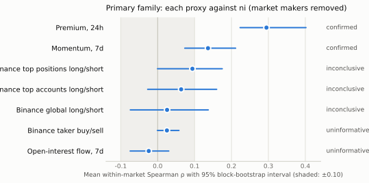
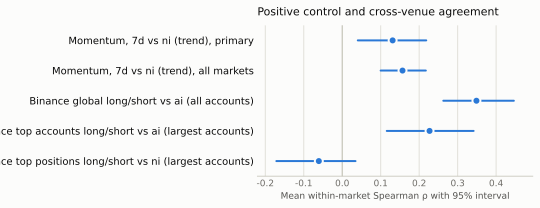
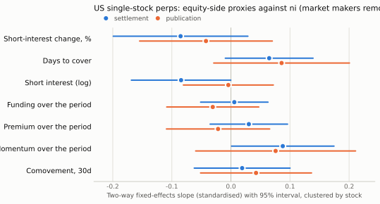

# Results

<!-- Generated by `herdbench report` from results/. Do not edit by hand: edit docs/deviations.md. -->

Every number below is read from the files in `results/`, whose SHA-256 hashes are listed in `results/manifest.json` (built 2026-11-23T15:31:48+00:00 with herdbench 1.0.0). The design was registered before any proxy was compared with the truth ([pre-registration](preregistration.md), [addendum](preregistration_addendum.md)).

## 1. Integrity gates and kill criteria

| Check | Result | Bar | Status |
|:---|:---|:---|:---|
| Reconciliation (all results) | 99.502% of changed notional over 261 snapshot pairs (market makers 99.128%, everyone else 99.528%; worst pair 33.599%) | ≥ 99% | pass |
| Gate 0 (all results) | maker = taker within 1% on 100.000% of 88,711 market-days (largest gap 0.00e+00) | ≥ 99% | pass |
| Kill criterion 1 (reported) | 21 US single-stock perps with ≥ 183 days of fills | ≥ 25 | fail (not gating) |
| Kill criterion 3 (settlement pairing) | clustered power 0.840 at ρ = 0.2 | ≥ 0.80 | pass |
| Kill criterion 3 (publication pairing) | clustered power 0.837 at ρ = 0.2 | ≥ 0.80 | pass |
| Kill criterion 4 (ranking claims) | Kendall τ between half-sample rankings n/a | ≥ 0.40 | no ranking claimed (fewer than 3 decisive verdicts) |

Snapshot pairs below 99% on their own: 2026-05-23 (33.6%), 2026-07-17 (65.3%). Every other pair reconciles in full; a short pair points to fills missing inside an archived day.

## 2. The truth panel

| Truth panel | Value |
|:---|:---|
| Snapshot dates | 305 (2025-08-28 to 2026-08-18) |
| Markets (eligible) | 404 (300) |
| Cohort cells (eligible) | 413,468 (184,938) |
| Eligible cells suppressed for publication | 21.6% |
| Primary market-days (non_mm, primary panel) | 8,784 |
| …of which suppressed | 0.7% (0.1% of their open interest) |
| Published rows | 260,121 |

## 3. Primary family: which public proxies track net positioning?

Truth: ni(non_mm), the net position of every account except market makers and protocol accounts, as a share of their gross position. Verdicts follow the pre-registration: *confirmed* needs the expected sign, Holm p < 0.05, |z̄| above the rotation null's 95th percentile and a fixed-effects slope of the same sign; *uninformative* means the 90% interval lies inside ±0.10.

30 markets, 297 common dates (a market-day is dropped for every proxy if any proxy or the truth is missing), block length 22 days, 7 proxies Holm-corrected together.

<picture>
  <source media="(prefers-color-scheme: dark)" srcset="figures/primary-dark.svg">
  <source media="(prefers-color-scheme: light)" srcset="figures/primary-light.svg">
  
</picture>

| Rank [95%] | Proxy | ρ | 95% CI | Holm p | Rotation 95% | FE slope | Verdict | ai(all) ρ |
|:---|:---|---:|---:|---:|---:|---:|:---|---:|
| 1 [1, 1] | `premium_24h` | 0.295 | [0.223, 0.402] | 0.007 | 0.118 | 38.316 | **confirmed** | 0.330 |
| 2 [2, 4] | `momentum_7d` | 0.136 | [0.073, 0.211] | 0.018 | 0.079 | 0.001 | **confirmed** | 0.309 |
| 3 [2, 7] | `bn_top_position_ls` | 0.094 | [-0.000, 0.175] | 0.265 | 0.110 | 0.036 | **inconclusive** | 0.318 |
| 4 [3, 7] | `bn_top_account_ls` | 0.064 | [-0.027, 0.160] | 0.597 | 0.061 | 0.022 | **inconclusive** | 0.326 |
| 5 [3, 7] | `bn_global_ls` | 0.026 | [-0.074, 0.137] | 0.770 | 0.056 | 0.019 | **inconclusive** | 0.349 |
| 6 [4, 7] | `bn_taker_ls` | 0.025 | [-0.001, 0.058] | 0.265 | 0.050 | -0.019 | **uninformative** | -0.075 |
| 7 [3, 7] | `oi_flow_7d` | -0.024 | [-0.074, 0.030] | 0.770 | 0.046 | -0.007 | **uninformative** | 0.110 |

Stability (half-samples split at 2026-03-23): unstable verdicts: none. No ranking is claimed (kill criterion 4); the ranks above are descriptive.

Rerun on the published panel only (in-sample, published panel): `premium_24h` 0.292, `momentum_7d` 0.134, `oi_flow_7d` -0.025, `bn_global_ls` 0.025, `bn_top_account_ls` 0.063, `bn_top_position_ls` 0.095, `bn_taker_ls` 0.027. Flag: **representative** (0.7% of primary market-days suppressed; the flag trips above 5%).

## 4. Positive control and cross-venue agreement

<picture>
  <source media="(prefers-color-scheme: dark)" srcset="figures/checks-dark.svg">
  <source media="(prefers-color-scheme: light)" srcset="figures/checks-light.svg">
  
</picture>

| Check | Pair | ρ | 95% CI | Markets | Reading |
|:---|:---|---:|---:|---:|:---|
| Positive control, primary panel | `momentum_7d` vs ni(trend) | 0.131 | [0.040, 0.218] | 30 | above 0 as required |
| Positive control, all_markets panel | `momentum_7d` vs ni(trend) | 0.157 | [0.100, 0.217] | 100 | above 0 as required |
| Cross-venue agreement | `bn_global_ls` vs ai(all) | 0.349 | [0.263, 0.446] | 30 |  |
| Cross-venue agreement | `bn_top_account_ls` vs ai(top_av) | 0.227 | [0.116, 0.341] | 30 |  |
| Cross-venue agreement | `bn_top_position_ls` vs ni(top_av) | -0.061 | [-0.171, 0.034] | 30 |  |

## 5. Secondary statistics (exploratory)

All-market panel (eligible main-dex markets with at least 60 days), cohort non_mm. Rows are flagged with Benjamini-Hochberg at q = 0.05 within each grid. Full grids, every cohort: `results/*.csv` and `results/binance/*.csv`.

**Directional proxies**

| Proxy | Truth | ρ | 95% CI | Cross-section ρ | Changes ρ | Placebo ρ | Sign agreement | BH flag |
|:---|:---|---:|---:|---:|---:|---:|---:|:---|
| `momentum_7d` | ai | 0.213 | [0.144, 0.292] | 0.200 | 0.097 | 0.014 | 0.598 | yes |
| `funding_7d` | ai | 0.191 | [0.103, 0.290] | 0.123 | 0.062 | -0.020 | 0.580 | yes |
| `premium_24h` | ai | 0.172 | [0.065, 0.270] | 0.106 | 0.009 | -0.026 | 0.518 | yes |
| `funding_24h` | ai | 0.151 | [0.036, 0.249] | 0.100 | -0.017 | -0.024 | 0.575 | yes |
| `oi_flow_7d` | ai | 0.067 | [0.034, 0.093] | 0.093 | 0.012 | -0.006 | 0.536 | yes |
| `funding_24h` | lwi | 0.083 | [0.030, 0.140] | 0.189 | 0.061 | -0.046 | 0.568 | yes |
| `premium_24h` | lwi | 0.082 | [0.023, 0.144] | 0.208 | 0.066 | -0.047 | 0.524 | yes |
| `funding_7d` | lwi | 0.075 | [-0.002, 0.136] | 0.165 | 0.012 | -0.072 | 0.560 | no |
| `oi_flow_7d` | lwi | 0.023 | [-0.011, 0.059] | 0.044 | -0.010 | -0.019 | 0.527 | no |
| `momentum_7d` | lwi | -0.157 | [-0.223, -0.102] | -0.048 | -0.186 | -0.043 | 0.452 | yes |
| `premium_24h` | ni | 0.308 | [0.253, 0.376] | 0.300 | 0.202 | -0.016 | 0.457 | yes |
| `funding_24h` | ni | 0.295 | [0.241, 0.353] | 0.289 | 0.159 | -0.014 | 0.729 | yes |
| `funding_7d` | ni | 0.200 | [0.138, 0.252] | 0.246 | 0.017 | -0.019 | 0.705 | yes |
| `momentum_7d` | ni | 0.121 | [0.067, 0.178] | 0.031 | 0.100 | 0.045 | 0.502 | yes |
| `oi_flow_7d` | ni | 0.006 | [-0.022, 0.038] | 0.054 | -0.006 | -0.018 | 0.548 | no |

**Crowding (unsigned) proxies**

| Proxy | Truth | ρ | 95% CI | Cross-section ρ | Changes ρ | Placebo ρ | Sign agreement | BH flag |
|:---|:---|---:|---:|---:|---:|---:|---:|:---|
| `oi_change_7d` | abs_ni | 0.089 | [0.041, 0.125] | 0.081 | -0.079 | 0.006 | n/a | yes |
| `liq_intensity_7d` | abs_ni | 0.005 | [-0.065, 0.078] | 0.018 | 0.045 | -0.066 | n/a | no |
| `abs_premium_24h` | abs_ni | -0.048 | [-0.100, 0.011] | -0.073 | -0.011 | 0.013 | n/a | no |
| `oi_to_volume_7d` | abs_ni | -0.066 | [-0.140, 0.009] | -0.039 | -0.071 | 0.042 | n/a | no |
| `oi_to_volume_7d` | coheld_share | 0.111 | [0.059, 0.148] | 0.176 | 0.027 | 0.020 | n/a | yes |
| `comovement_30d` | coheld_share | 0.067 | [-0.014, 0.132] | 0.276 | 0.023 | -0.040 | n/a | no |
| `abs_premium_24h` | coheld_share | -0.013 | [-0.042, 0.036] | 0.010 | 0.016 | -0.021 | n/a | no |
| `liq_intensity_7d` | coheld_share | -0.052 | [-0.100, 0.011] | -0.185 | 0.014 | -0.030 | n/a | no |
| `oi_change_7d` | coheld_share | -0.074 | [-0.115, -0.032] | -0.030 | 0.039 | -0.009 | n/a | yes |
| `liq_intensity_7d` | fragile_share | 0.060 | [-0.031, 0.132] | 0.421 | -0.062 | -0.015 | n/a | no |
| `oi_change_7d` | fragile_share | 0.017 | [-0.021, 0.050] | 0.004 | -0.009 | -0.001 | n/a | no |
| `oi_to_volume_7d` | fragile_share | -0.048 | [-0.132, 0.056] | -0.349 | 0.046 | 0.039 | n/a | no |
| `abs_premium_24h` | fragile_share | -0.072 | [-0.107, -0.022] | 0.023 | 0.003 | -0.029 | n/a | yes |
| `oi_to_volume_7d` | top10_share | 0.192 | [0.135, 0.235] | 0.019 | 0.031 | 0.018 | n/a | yes |
| `oi_change_7d` | top10_share | 0.000 | [-0.030, 0.031] | -0.025 | 0.008 | 0.008 | n/a | no |
| `abs_premium_24h` | top10_share | -0.068 | [-0.120, -0.021] | 0.032 | -0.043 | -0.011 | n/a | yes |
| `liq_intensity_7d` | top10_share | -0.116 | [-0.156, -0.071] | 0.149 | -0.030 | 0.001 | n/a | yes |

**Sensitivity: flow proxies on complete 7-day windows** (cohort non_mm; see Deviations)

| Panel | Proxy | Truth | ρ (registered) | ρ (complete windows) | 95% CI | N |
|:---|:---|:---|---:|---:|---:|---:|
| primary | `liq_intensity_7d` | abs_ni | -0.057 | 0.053 | [-0.097, 0.145] | 2,826 |
| primary | `liq_intensity_7d` | top10_share | -0.112 | -0.139 | [-0.208, -0.038] | 2,826 |
| primary | `liq_intensity_7d` | fragile_share | -0.040 | -0.296 | [-0.430, -0.089] | 2,826 |
| primary | `liq_intensity_7d` | coheld_share | -0.019 | -0.006 | [-0.067, 0.110] | 2,826 |
| primary | `oi_to_volume_7d` | abs_ni | -0.043 | -0.179 | [-0.313, 0.032] | 2,826 |
| primary | `oi_to_volume_7d` | top10_share | 0.233 | 0.173 | [0.070, 0.274] | 2,826 |
| primary | `oi_to_volume_7d` | fragile_share | 0.085 | 0.410 | [0.154, 0.534] | 2,826 |
| primary | `oi_to_volume_7d` | coheld_share | 0.035 | 0.023 | [-0.128, 0.121] | 2,826 |
| all_markets | `liq_intensity_7d` | abs_ni | 0.005 | 0.072 | [-0.036, 0.159] | 7,376 |
| all_markets | `liq_intensity_7d` | top10_share | -0.116 | -0.140 | [-0.173, -0.109] | 7,376 |
| all_markets | `liq_intensity_7d` | fragile_share | 0.060 | -0.169 | [-0.293, -0.015] | 7,376 |
| all_markets | `liq_intensity_7d` | coheld_share | -0.052 | -0.081 | [-0.113, -0.000] | 7,376 |
| all_markets | `oi_to_volume_7d` | abs_ni | -0.066 | -0.184 | [-0.264, -0.052] | 7,376 |
| all_markets | `oi_to_volume_7d` | top10_share | 0.192 | 0.201 | [0.128, 0.255] | 7,376 |
| all_markets | `oi_to_volume_7d` | fragile_share | -0.048 | 0.243 | [0.053, 0.359] | 7,376 |
| all_markets | `oi_to_volume_7d` | coheld_share | 0.111 | 0.148 | [0.059, 0.190] | 7,376 |

## 6. Second target: liquidations in the next 7 days

| Predictor | Kind | Target | Mean daily ρ | NW s.e. | p | Partial ρ (rv_7d) | BH flag | Variant |
|:---|:---|:---|---:|---:|---:|---:|:---|:---|
| `abs_premium_24h` | proxy | liquidation intensity | 0.019 | 0.031 | 0.534 | 0.019 | no | registered |
| `oi_change_7d` | proxy | liquidation intensity | -0.006 | 0.025 | 0.824 | -0.009 | no | registered |
| `comovement_30d` | proxy | liquidation intensity | 0.160 | 0.024 | <0.001 | 0.189 | yes | registered |
| `liq_intensity_7d` | proxy | liquidation intensity | 0.483 | 0.022 | <0.001 | 0.490 | yes | registered |
| `oi_to_volume_7d` | proxy | liquidation intensity | -0.430 | 0.034 | <0.001 | -0.441 | yes | registered |
| `abs_ni` | truth | liquidation intensity | 0.067 | 0.026 | 0.009 | 0.068 | yes | registered |
| `top10_share` | truth | liquidation intensity | 0.192 | 0.013 | <0.001 | 0.232 | yes | registered |
| `fragile_share` | truth | liquidation intensity | 0.472 | 0.020 | <0.001 | 0.498 | yes | registered |
| `coheld_share` | truth | liquidation intensity | -0.166 | 0.027 | <0.001 | -0.166 | yes | registered |
| `premium_24h` | proxy | long minus short liquidations | 0.009 | 0.017 | 0.585 | n/a | no | registered |
| `momentum_7d` | proxy | long minus short liquidations | -0.162 | 0.025 | <0.001 | n/a | yes | registered |
| `oi_flow_7d` | proxy | long minus short liquidations | -0.014 | 0.013 | 0.282 | n/a | no | registered |
| `funding_24h` | proxy | long minus short liquidations | 0.016 | 0.016 | 0.333 | n/a | no | registered |
| `funding_7d` | proxy | long minus short liquidations | 0.034 | 0.019 | 0.077 | n/a | no | registered |
| `ni` | truth | long minus short liquidations | 0.027 | 0.024 | 0.262 | n/a | no | registered |
| `ai` | truth | long minus short liquidations | -0.044 | 0.019 | 0.019 | n/a | yes | registered |
| `lwi` | truth | long minus short liquidations | 0.076 | 0.018 | <0.001 | n/a | yes | registered |
| `liq_intensity_7d` | proxy | liquidation intensity | 0.486 | 0.039 | <0.001 | 0.493 | n/a | complete windows |
| `oi_to_volume_7d` | proxy | liquidation intensity | -0.449 | 0.050 | <0.001 | -0.451 | n/a | complete windows |

Δρ: fragile_share minus the best unsigned proxy (chosen on one half, scored on the other):

| Chosen on | Scored on | Best proxy | Δρ | 95% CI |
|:---|:---|:---|---:|---:|
| first | second | `liq_intensity_7d` | -0.036 | [-0.102, 0.032] |
| second | first | `liq_intensity_7d` | 0.014 | [-0.026, 0.061] |

## 7. Transfer to US single-stock perpetuals

<picture>
  <source media="(prefers-color-scheme: dark)" srcset="figures/transfer-dark.svg">
  <source media="(prefers-color-scheme: light)" srcset="figures/transfer-light.svg">
  
</picture>

**Settlement pairing**: 40 stocks, 17 settlement dates, 378 stock-dates; clustered power 0.840 (p-values reported).

| Proxy | Expected | β (std.) | 95% CI | p | Two-way s.e. | N |
|:---|:---:|---:|---:|---:|---:|---:|
| `si_change_pct` | - | -0.085 | [-0.199, 0.029] | 0.138 | 0.042 | 378 |
| `days_to_cover` | - | 0.065 | [-0.009, 0.139] | 0.086 | 0.038 | 378 |
| `log_short_interest` | - | -0.084 | [-0.169, -0.000] | 0.049 | 0.045 | 378 |
| `funding_period` | + | 0.006 | [-0.051, 0.063] | 0.840 | 0.022 | 378 |
| `premium_period` | + | 0.030 | [-0.035, 0.096] | 0.355 | 0.031 | 378 |
| `momentum_period` | + | 0.088 | [0.001, 0.174] | 0.047 | 0.041 | 366 |
| `comovement_30d` | + | 0.019 | [-0.062, 0.100] | 0.638 | 0.039 | 363 |

**Publication pairing**: 41 stocks, 16 settlement dates, 361 stock-dates; clustered power 0.837 (p-values reported).

| Proxy | Expected | β (std.) | 95% CI | p | Two-way s.e. | N |
|:---|:---:|---:|---:|---:|---:|---:|
| `si_change_pct` | - | -0.042 | [-0.155, 0.070] | 0.452 | 0.058 | 361 |
| `days_to_cover` | - | 0.086 | [-0.029, 0.201] | 0.139 | 0.066 | 361 |
| `log_short_interest` | - | -0.004 | [-0.080, 0.072] | 0.908 | 0.037 | 361 |
| `funding_period` | + | -0.031 | [-0.109, 0.047] | 0.430 | 0.049 | 361 |
| `premium_period` | + | -0.022 | [-0.109, 0.066] | 0.617 | 0.054 | 361 |
| `momentum_period` | + | 0.076 | [-0.060, 0.211] | 0.265 | 0.070 | 351 |
| `comovement_30d` | + | 0.042 | [-0.051, 0.136] | 0.366 | 0.035 | 346 |

Source and owner of the short-interest data: FINRA. Summary statistics only; non-commercial use.

## 8. Futures bridges (description only)

**Managed money (metals, energy) or leveraged funds (indices, FX, CME crypto)**

| Perp | Weeks | Spearman ρ | p (descriptive) |
|:---|---:|---:|---:|
| BTC | 43 | -0.103 | 0.510 |
| ETH | 43 | 0.259 | 0.093 |
| xyz:CL | 31 | -0.066 | 0.725 |
| xyz:COPPER | 30 | -0.251 | 0.181 |
| xyz:EUR | 31 | 0.137 | 0.462 |
| xyz:GOLD | 33 | 0.314 | 0.075 |
| xyz:JPY | 29 | 0.022 | 0.909 |
| xyz:NATGAS | 26 | -0.029 | 0.888 |
| xyz:PALLADIUM | 2 | n/a | n/a |
| xyz:PLATINUM | 25 | 0.128 | 0.543 |
| xyz:SILVER | 33 | -0.115 | 0.525 |
| xyz:SP500 | 21 | 0.199 | 0.388 |
| xyz:XYZ100 | 37 | 0.212 | 0.208 |

**Asset managers (financial futures only)**

| Perp | Weeks | Spearman ρ | p (descriptive) |
|:---|---:|---:|---:|
| BTC | 43 | 0.061 | 0.699 |
| ETH | 43 | -0.195 | 0.211 |
| xyz:EUR | 31 | -0.015 | 0.935 |
| xyz:JPY | 29 | -0.434 | 0.019 |
| xyz:SP500 | 21 | -0.326 | 0.149 |
| xyz:XYZ100 | 37 | 0.252 | 0.132 |

## 9. Robustness: market-maker rule variants (primary panel, ni)

| Proxy | non_mm_s070 | non_mm_s090 | non_mm_t020 | non_mm_t100 |
|:---|---:|---:|---:|---:|
| `bn_global_ls` | 0.017 | 0.012 | 0.054 | -0.035 |
| `bn_taker_ls` | 0.024 | 0.027 | 0.001 | 0.092 |
| `bn_top_account_ls` | 0.062 | 0.021 | 0.078 | -0.021 |
| `bn_top_position_ls` | 0.095 | 0.125 | 0.133 | 0.001 |
| `momentum_7d` | 0.172 | 0.145 | 0.186 | 0.128 |
| `oi_flow_7d` | -0.018 | -0.044 | 0.002 | -0.043 |
| `premium_24h` | 0.326 | 0.266 | 0.387 | 0.195 |

## 10. Deviations from the pre-registration

Every departure from [the pre-registration](preregistration.md) is listed here with its reason and its effect.
This list was written before any proxy was compared with the truth and is reproduced verbatim in
[results.md](results.md).

1. **The Barone-Lillo appendix was not run.** Section 11 lists their TWAP coefficient (θ = -0.0177, s.e. 0.0010,
   arXiv 2606.15715) as an appendix that gates nothing. Reproducing it means rebuilding both of their metaorder
   definitions (protocol TWAPs and statistical runs) and their regression sample, which is a separate replication
   study rather than a measurement of crowding proxies. It is left out of version 1.0 rather than shipped
   half-verified; the registered parameters stay in `PREREG` for a later release. No result in this release
   depends on it.

2. **Window of `dtl` (days to liquidate).** Section 9 defines dtl as |non_mm net notional| ÷ mean daily volume
   without fixing the window. HerdBench uses the mean daily taker volume over the days of [c - 7d, c) that have
   archived fills (a day missing from the archive is left out of the mean, not counted as zero), and publishes dtl
   for every cohort, each with its own net notional. As registered, dtl is published and never scored against
   `oi_to_volume_7d`.

3. **Which market-days supplied the top-3 holders for the entity map.** Section 4 maps every address that is ever
   one of the three largest holders of an *eligible* market (open interest of at least $1M at the previous
   snapshot). The lookup list was built from markets with at least $1M of open interest on the *same* snapshot.
   The two definitions differ only on days when a market crosses $1M, and the map only merges sub-accounts into
   their master, so the worst case is an entity counted as two in such a market. The list is reproduced exactly
   by `herdbench.truth.build.entity_map_targets`.

4. **Seven-day fill windows that touch a day missing from the archive (added sensitivity check).** The archive
   lacks 38 single days of fills between August 2025 and August 2026, so only 109 of the 305 evaluation snapshots
   have a complete seven-day window behind them. The registered code (`proxies/native.py` at the registering
   commit) counts a missing day as a day with no volume and no liquidations, which biases `liq_intensity_7d`
   down and `oi_to_volume_7d` up on the affected market-days; section 9's rule of dropping such windows was
   written for the liquidation target only. The registered version is run and is the main result. Added after
   registration and before any proxy was compared with the truth: the same statistics with both flow proxies kept
   only on complete windows (`results/sensitivity_complete_flows.csv` and the "complete windows" rows of
   `results/liquidation_target.csv`). No confirmatory proxy uses a seven-day fill window.
